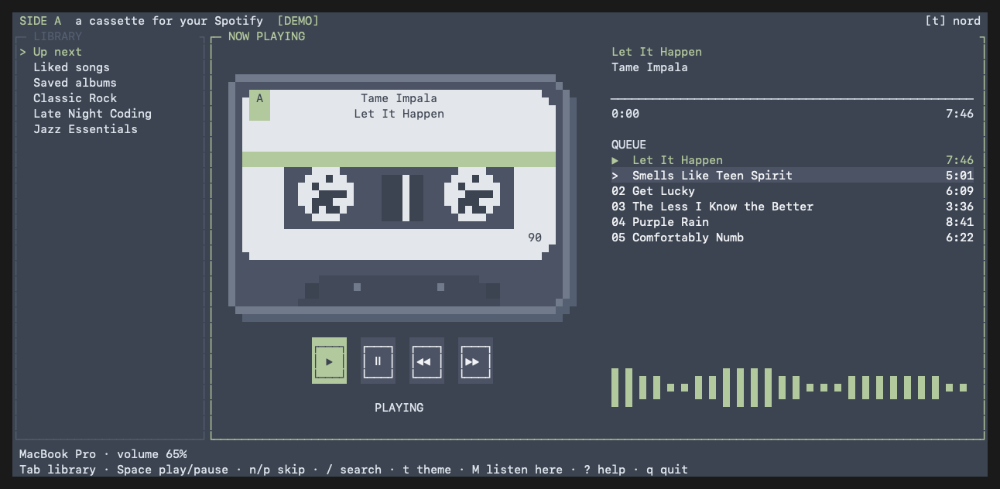

# Side A

*A cassette for your Spotify.*

A terminal Spotify player with a pixel cassette, separate library, track
controls, queue, a live centered spectrum, and eight color themes.

Built for macOS and Spotify Premium. It also builds and runs on Windows
(see below); Windows audio output has had less testing than macOS.



## Get started

### macOS

Install the dependencies and build from source:

```sh
brew install go librespot
git clone https://github.com/ericonyourphone/sidea.git
cd sidea
make build
./sidea
```

Optional: `make install` installs the `sidea` command into Go’s bin directory,
which must be on your shell’s PATH.

### Windows

You need [Git](https://git-scm.com/download/win), Go, and librespot. In
PowerShell, using [Scoop](https://scoop.sh) for Go and
[Rust](https://rustup.rs) (Cargo) for librespot, which Scoop doesn't carry:

```powershell
scoop install go
cargo install librespot

git clone https://github.com/ericonyourphone/sidea.git
cd sidea
go install -tags demo -ldflags "-X main.version=v0.1.0-dev" .
```

This installs `sidea.exe` into `%USERPROFILE%\go\bin` and librespot into
`%USERPROFILE%\.cargo\bin`. Make sure both folders are on your PATH (the Go
and Rust installers normally add them), then open a new terminal and run:

```powershell
sidea demo   # offline demo, no Spotify needed
sidea        # connect Spotify and start playing
```

`make` isn't required on Windows. To build a local `sidea.exe` in the repo
instead of installing, run
`go build -tags demo -ldflags "-X main.version=v0.1.0-dev" -o sidea.exe .`.
Without `-tags demo`, `sidea demo` is unavailable.

If Windows Application Control or antivirus blocks a freshly built binary,
allow it or build from a different folder.

The first launch guides you through connecting Spotify and setting up
local playback. For a personal Spotify developer app, use `./sidea auth --own`.
You can set up the audio player separately with `./sidea player login`.

Quit another terminal player first to avoid competing media-key handlers.
Press **M** to transfer playback to Side A's local device; the spectrum
measures Side A's own audio. Other Spotify devices can be controlled, but
their audio is not available to the analyzer.

When Spotify refuses access to a playlist’s track list, Side A shows that
restriction instead of reporting an empty playlist. Press Enter in that
view to request playback of the entire playlist; Q returns to the queue.

`sidea demo` opens an offline demo with sample songs and a simulated
spectrum. It never connects to Spotify or plays audio.

Native output is built into Side A; ffplay is not required.
Spotify's personal developer-app restrictions can limit which playlists
or endpoints are available. Side A surfaces those errors in the status line.

## Controls

| Key | Action |
| --- | --- |
| Tab, h/l | Switch library / song list |
| j/k or arrows | Move selection |
| Enter | Open collection or play selected song |
| Space | Play / pause |
| n / p | Next / previous |
| [ / ] | Seek backward / forward five seconds |
| + / - | Spotify playback volume |
| M | Play through Side A on this Mac |
| D | Pick a Spotify device |
| / | Open search for artists, songs, and albums |
| a | Add selected track to the Spotify queue |
| Q or Escape | Return to Up next |
| t | Cycle themes |
| :theme nord | Select a theme by name |
| ? | Help |
| q or Ctrl+C | Quit |

The cassette and song list share one player panel, with a separate library.
A playing song has a persistent accent-colored ▶ marker; the selection
cursor uses > with a neutral highlight. In the queue, the current song
appears above the upcoming tracks. The bottom visualizer uses solid bars
mirrored around a center line, like a classic cassette player.

Transport buttons and the progress bar also accept mouse clicks. Clicking
an upcoming song advances through the queue to it. Selecting a song from
a library collection starts playback in that collection where supported.
Liked songs, playlists, and saved albums can be browsed; playlist and liked
song pages load as you approach the bottom of the loaded list.

Search opens a centered popup with Artists, Songs, and Albums tabs.
Type a query and press Enter, then use Tab or left/right to switch result
types and up/down to select. Enter plays a song or opens the artist/album
in the song pane. Click tabs or results with the mouse. Press / to edit
the query and Escape to close, preserving the library/queue behind it.
The popup displays Spotify’s first page of results in each category.

A wide terminal (110 columns or more) shows library, cassette, and songs
side by side. At medium widths Tab swaps the library and cassette in the
left pane. Below 78 columns, Tab switches between the library and songs.
The minimum size is 60 × 20. The spectrum continues while another window
has focus.

## Themes and settings

Themes: Spotify, Catppuccin Mocha, Catppuccin Latte, Gruvbox, Tokyo Night,
Nord, Dracula, and Rosé Pine. The cassette, controls, text, and spectrum
all use the active palette. `t` and `:theme`
persist the theme in Side A's own settings.

Settings and authentication are stored under `~/.config/sidea/` (or
`$XDG_CONFIG_HOME/sidea/`); they are never project files. Each installation
keeps its own Spotify login and local-player credentials there.

Audio: librespot requests 320 kbps, decodes stereo 16-bit/44.1 kHz PCM,
and sends it to Oto's native Mac audio output. The spectrum analyzes a copy
of the samples consumed by that output. The audio is not recorded.

## Development

```sh
make check
./sidea demo snapshot --width 140 --height 30 --theme nord
./sidea demo snapshot --width 140 --height 30 --theme nord --search "Pink Floyd"
```

The snapshot command renders the real interface without a terminal or
network. Add `--color` to include true-color terminal escapes.

`ui/` contains Side A's interface and focused interaction/layout tests.
`player/` and `spectrum/` contain native playback and the FFT analyzer.
`auth/`, `spotify/`, `cli/`, and `media/` handle login, API access, command-line
controls, and system media controls. `app/` supplies shared onboarding and
theme support; `ui/` contains the current interface.

The optional GitHub Actions check is provided in `ci/github-actions.yml`.
To enable it, move it to `.github/workflows/ci.yml` using a GitHub login
with permission to manage workflows.

Side A is an early development project. No packaged release or Homebrew
formula is available yet. `SIDEA_LOG=/path/to/log sidea`
enables diagnostic logging. Log files can contain listening history and
should not be committed.

## License

GPL-3.0. Derived from an upstream GPL-3.0 project, with a new
interface and native audio spectrum work added on November 10, 2026.
See [LICENSE](LICENSE) and [attribution](UPSTREAM.md).

Side A is not an official Spotify app.
